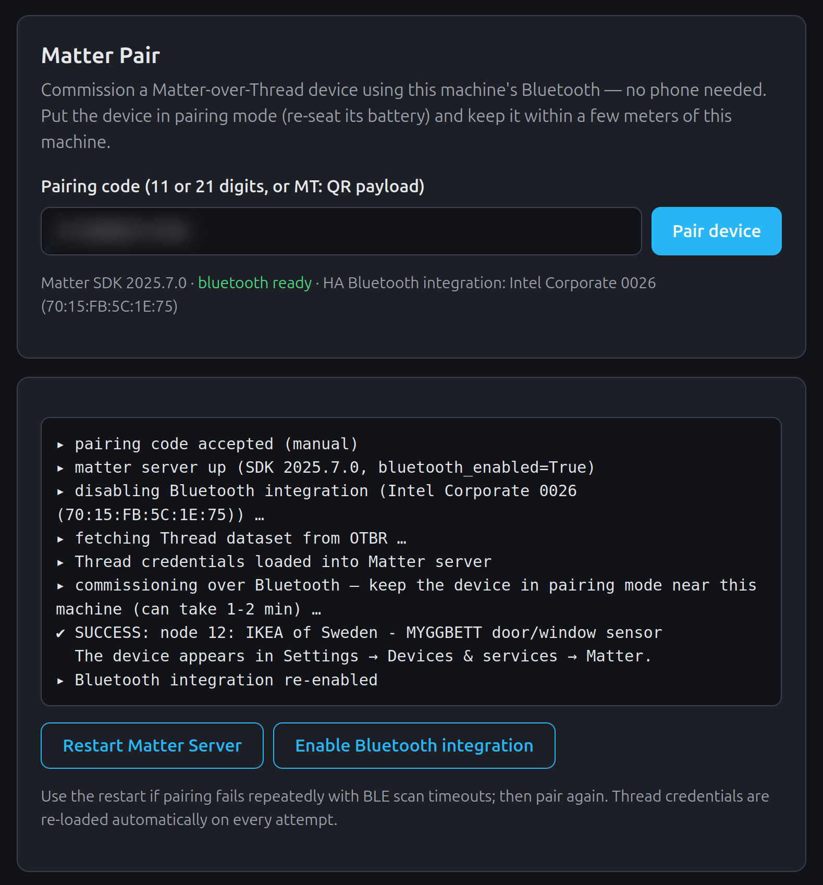

# Matter Pair — commission Matter devices without a phone

A Home Assistant add-on that commissions **Matter-over-Thread** devices using
the Home Assistant machine's **own Bluetooth adapter**, instead of the
companion app on your phone.

> [!NOTE]
> **Home Assistant has built-in ways to do this now.** The Matter Server
> add-on's own Web UI has a **Commission node** button (add-on page → *Open
> Web UI*), and recent releases add a phone-free flow in the core UI
> (*Add Matter device* → enter the code manually) plus BLE-proxy commissioning
> in the matterjs-based Matter Server 9.x beta. Try those first. Matter Pair
> remains useful as a one-button wrapper that also automates two sharp edges
> of the stable Matter Server: it disables the HA Bluetooth integration during
> pairing (it can starve the Matter SDK's BLE scan) and re-loads the live
> Thread dataset from OTBR before every attempt (the server forgets it on
> restart).

## Why

The official pairing flow requires the HA companion app, which hands the
Bluetooth onboarding to Google Play Services (Android) or the Matter framework
(iOS). When that flow breaks — for example the Android 17 bug where Google
Play Services insists you are "not connected to Wi-Fi" no matter what — you
are locked out of adding Matter devices entirely.

The Matter server that ships with Home Assistant can do the BLE part itself,
and its Web UI even exposes a commission button — but a successful pair can
still mean juggling the Bluetooth integration, Thread credentials and server
restarts in the right order. This add-on wraps all of that into a single page:
type the pairing code, press one button.

## What it does per pairing attempt

1. **Disables the HA Bluetooth integration** — while it holds the adapter, the
   Matter SDK's BLE scan times out.
2. **Loads the live Thread dataset** from the OpenThread Border Router add-on
   into the Matter server (the server does not persist it across restarts).
3. Runs **`commission_with_code`** over the host's Bluetooth adapter.
4. **Re-enables the Bluetooth integration** — also when pairing failed.

Progress streams live into the page. Buttons are included to restart the
Matter Server (recovers a wedged BLE scan) and to force-re-enable the
Bluetooth integration.

## Requirements

- Home Assistant OS (or Supervised) with:
  - **Matter Server** add-on, with `bluetooth_adapter_id: 0` added to its
    configuration (Settings → Add-ons → Matter Server → Configuration →
    three-dot menu → Edit in YAML), then restart it;
  - **OpenThread Border Router** add-on running your Thread network;
  - a working **Bluetooth adapter** on the machine.
- The device must be in pairing mode **within Bluetooth range of the HA
  machine** during commissioning. Once joined, it talks Thread and can live
  anywhere in Thread coverage.

## Installation

### As an add-on repository

Click the **Add repository** badge above, or go to Settings → Add-ons →
Add-on store → ⋮ → Repositories and add this repository's URL. Then install
**Matter Pair** from the store, start it, and enable "Show in sidebar".

### As a local add-on

Copy the `matter_pair/` directory to `/addons/` on your HA machine, then
Settings → Add-ons → Add-on store → ⋮ → Check for updates, and install
**Matter Pair** from the "Local add-ons" section.

## Usage

1. Open **Matter Pair** in the sidebar.
2. Put the device in pairing mode (fresh battery / pairing button) near the
   HA machine.
3. Enter the 11- or 21-digit pairing code (dashes/spaces fine) or the full
   `MT:` QR payload, and press **Pair device**.
4. Watch the log; on success the device appears under
   Settings → Devices & services → Matter.

## Troubleshooting

- **"BLE scan timeout" / repeated failures** — press *Restart Matter Server*,
  wait for it to come back, and pair again (Thread credentials are re-loaded
  automatically each attempt).
- **"Discovery timed out"** — the device wasn't advertising: re-seat its
  battery (the pairing window is short, typically ~15 minutes) and move it
  closer to the machine.
- **"Matter Server has no Bluetooth"** — add `bluetooth_adapter_id: 0` to the
  Matter Server add-on's YAML config and restart it.
- The status line at the top of the page shows the Matter server's SDK
  version, whether its Bluetooth is enabled, and the state of HA's Bluetooth
  integration.

## Security notes

- The add-on talks only to local APIs (Matter server, OTBR, HA core via the
  Supervisor proxy) with the Supervisor-issued token; it has no configuration
  options and stores nothing.
- It needs `homeassistant_api` (to toggle the Bluetooth integration) and
  `hassio_role: manager` (to restart the Matter Server add-on).

## Development

Source layout follows the standard HA add-on repository convention:
`repository.yaml` at the root, the add-on in [`matter_pair/`](matter_pair/)
(manifest, Dockerfile, a single-file aiohttp backend and a single-page UI).
See [`matter_pair/DOCS.md`](matter_pair/DOCS.md) for the iteration workflow.

## License

[MIT](LICENSE)
